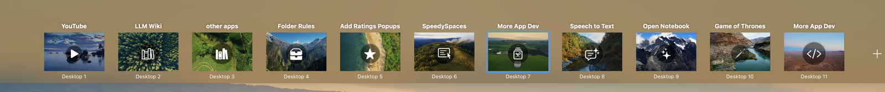

# SpeedySpaces

**Name, icon, and fly between your macOS Spaces.**

SpeedySpaces is a menu bar app that makes macOS virtual desktops first-class: give every
Space a name and an icon, see them in the menu bar and in Mission Control itself, switch
with hotkeys, gestures, Shortcuts, or a click — and manage desktops (add, remove,
reorder) without ever leaving the keyboard.

No SIP disabling, no code injection, no kernel extensions. One notarizable app bundle.



## Highlights

### Names and icons everywhere

- **Rename any Space** and assign an **SF Symbol** (searchable, categorized picker of
  ~230 curated symbols) or **emoji**. Identity is keyed to the window server's stable
  space UUID, so labels survive reboots and Space reshuffles.
- **Mission Control labels** — your names and icons appear on Apple's *actual* Mission
  Control: names above each thumbnail (Apple's "Desktop N" caption stays untouched
  below), icons inline, above, or centered on the thumbnail with a translucent circular
  badge. Click a label in Mission Control to rename that Space on the spot.
- Labels move **in sync with Mission Control's own animations**. The overlay listens for
  window-server layout commits (which carry final geometry before the visuals start) and
  replays the native animation curve open-loop, rather than chasing pixels — so labels
  ride add/remove/reorder glides instead of trailing them.

### Menu bar


- Show the **current Space's icon, name, and/or number** — any combination.
- Optional **workspace list**: one clickable segment per Space (numbered squares or
  icons), with the current Space highlighted. Hover tooltips, size slider, optional
  backgrounds.
- **Multi-display aware**: follow the focused display, collapse unfocused displays to
  their current Space, or hide single-Space displays entirely.

### Switcher


- A wallpaper-thumbnail switcher HUD in two styles — **Mimic Mission Control**
  (full-width bar along the top edge) or **Classic Popover** (compact, centered) — plus
  an option to use the **native Mission Control** bar instead.
- Appears when you change Spaces (configurable minimum on-screen time) and/or while
  **holding a key**; click a tile to switch, drag tiles to **reorder Spaces** —
  including across displays — without opening Mission Control.
- Add and remove desktops from the app; removal and creation drive Mission Control's
  own controls, so macOS state stays consistent.

### Switching engines

Space switching is pluggable — pick the engine in Settings, each independently
verifiable with a built-in probe:

| Engine | Mechanism | Notes |
|---|---|---|
| **Gesture** (default) | Synthesizes the trackpad dock-swipe at the IOHID payload level | Instant or animated ("Natural") delivery |
| **Keyboard** | Replays your configured Mission Control shortcuts (⌃N / ⌃←→) | The classic approach |
| **Window focus** | Fronts a window living on the target Space | Can work without Accessibility; can't reach empty desktops |
| **Mission Control** | Presses the target's tile via the Accessibility surface | Availability depends on the OS exposing that surface |

### Shortcuts, hotkeys, automation

- **Per-Space global hotkeys** with an in-app shortcut recorder, plus global-modifier
  schemes (e.g. one modifier + number jumps to that Space) and wrap-around stepping.
- **Caps Lock hyper key**: map Caps Lock to a modifier set (default ⌘⌥⌃) while held —
  Karabiner's classic remap, without a virtual HID driver.
- **macOS Shortcuts**: six App Intents (Switch to Space, Next/Previous Space, Show
  Switcher, Open Mission Control view, Rename Current Space).
- **URL scheme**: `speedyspaces://switch?...`, `next`, `prev`, `back`, `switcher`,
  `mission-control`, `menu`, `settings`, `rename` — scriptable from anywhere.
- **CLI**: the app binary doubles as a command-line tool (`--switch`, `--next`,
  `--prev`, `--switcher`, `--dump`, …).
- **Configuration export/import** — names, icons, shortcuts, and preferences in one
  JSON file, with ordinal-based re-keying so a backup restores across machines.

## Requirements

- **macOS 14+** (developed and tested through macOS 27). SpeedySpaces uses private
  window-server APIs, so it can't ship on the Mac App Store — distribute directly,
  notarized.
- **Accessibility permission** (System Settings → Privacy & Security → Accessibility)
  for switching, hotkeys, and instant Mission Control dismissal detection. The app
  degrades gracefully without it.
- Not sandboxed. No Screen Recording, no Input Monitoring, no SIP changes.

## Build & run

No full Xcode required — the Swift toolchain / Command Line Tools suffice:

```sh
./build.sh                     # produces build/SpeedySpaces.app (+ a DMG)
open build/SpeedySpaces.app
```

Sign with a stable identity so the Accessibility grant survives rebuilds (ad-hoc
signatures change every build and macOS silently drops the grant):

```sh
SIGN_IDENTITY="Apple Development: you@example.com" ./build.sh
```

Quick health checks, no GUI needed:

```sh
BIN=build/SpeedySpaces.app/Contents/MacOS/SpeedySpaces
"$BIN" --selftest      # pure-logic unit tests, prints ALL PASS
"$BIN" --dump          # enumerate spaces as the app sees them
```

To work in Xcode: `xcodegen generate && open SpeedySpaces.xcodeproj`.

## How it works

| Concern | Mechanism |
|---|---|
| Enumerate Spaces / current Space | `CGSCopyManagedDisplaySpaces` and friends, resolved at runtime via `dlsym` (`CGSShim.c`) |
| Space identity | The window server's stable per-Space UUID; all metadata is keyed by it |
| Mission Control labels | Shield-level click-through overlay per display; tile windows discovered by layer + geometry from the public window list |
| Label motion | SLS per-window notifications (`SLSRequestNotificationsForWindows`): layout commits deliver final tile bounds before the visible glide starts; labels replay the measured native spring open-loop, with frame-rate sampling as the fallback |
| Switching | Pluggable engines (see above), outcome-verified after each switch |
| Reordering | The Dock's own managed-space move call, verified and restored on failure |
| Persistence | JSON under `~/Library/Application Support/SpeedySpaces/` |

Every private symbol is resolved defensively and feature-detected: if a future macOS
renames or removes one, the dependent feature degrades or disables instead of crashing
the app. The Mission Control overlay in particular falls back from event-driven replay
to sampled tracking if the notification surface disappears.

## Source layout

```
Sources/SpeedySpaces/
  CGSPrivate.h / CGSShim.c      private window-server bridge (dlsym, feature-detected)
  SpacesManager / Space         enumeration, current-space tracking, model
  MetadataStore / SpaceMetadata names, icons, shortcuts — persisted by space UUID
  StatusItemController          menu bar item + dynamic menu
  MenuBarStripView              the menu bar strip (segments, tooltips, click targets)
  MissionControlOverlay         Mission Control labels: discovery, SLS events, replay springs
  SwitcherHUD / SwitcherPanel   the switcher popup (both styles), drag-to-reorder
  SpaceSwitcher + engines       gesture / keyboard / windowFocus / missionControl
  SpaceMutator                  add/remove desktops by driving Mission Control
  HotkeyManager / CapsLockHyperKey / GestureSwitcher   input machinery
  SettingsWindow                Settings (General · Menu Bar · Switcher · Thumbnails · Shortcuts)
  SpeedySpacesIntents           App Intents (Shortcuts) over the URL scheme
```

## Testing

`--selftest` runs the headless unit suite (300+ checks). `TESTING.md` documents the
interactive probes — switching bake-offs (`--probe-switch`), space mutation and reorder
probes, menu bar and switcher render probes (`--probe-strip`, `--probe-switcher`), and
more. The research notes behind the Mission Control overlay (measured animation
contracts, dead ends, and the window-server event census on current betas) live in the
repository's research documents (`FEASIBILITY.md`, `mission-control-labels.md`,
`fix-workspace-lag.md`).

## License

Not yet licensed for redistribution — all rights reserved for now.
