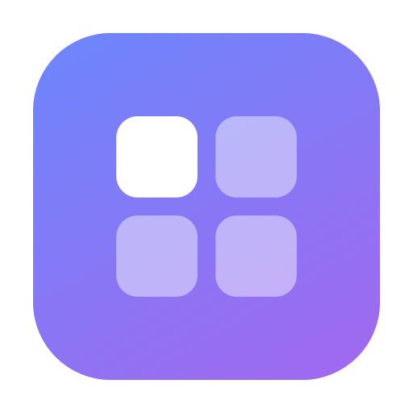
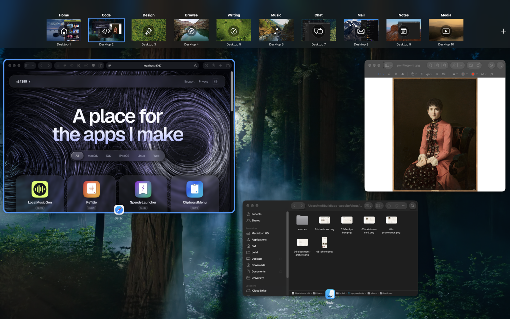
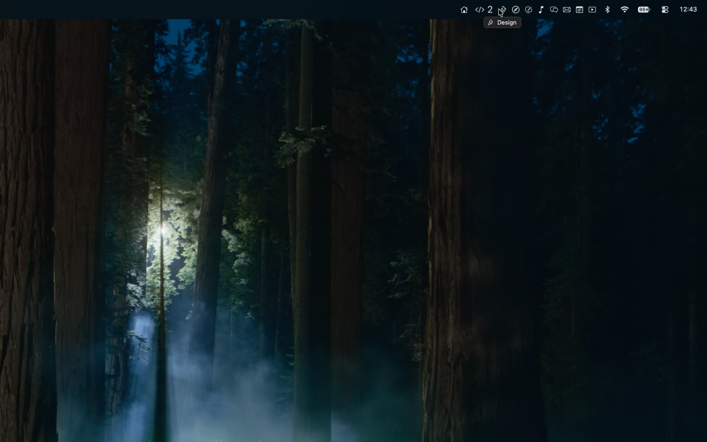
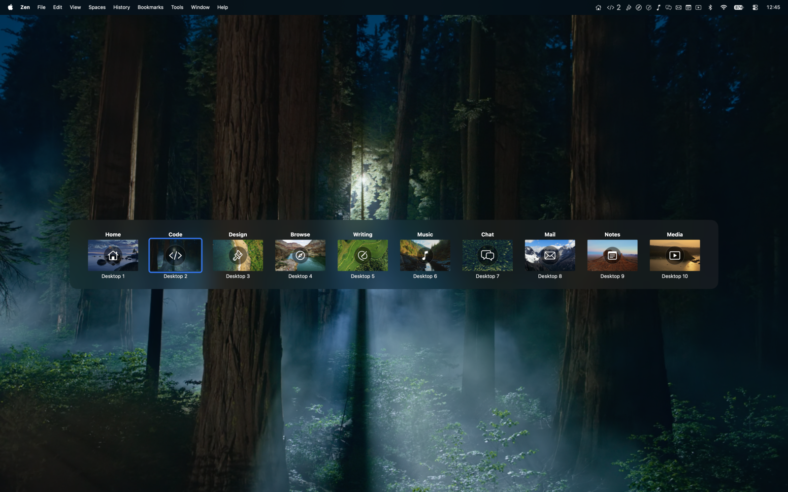

<p align="center">
  
</p>

<h1 align="center">SpeedySpaces</h1>

A macOS menu bar app that gives your Spaces names, icons, and shortcuts.

macOS calls them "Desktop 1" through "Desktop 9" and gives you no way to tell them apart.
SpeedySpaces names them, puts those names in the menu bar and in Mission Control itself,
and lets you jump between them with a hotkey, a gesture, or a click.



## Features

**Names and icons.** Rename any Space and give it an SF Symbol or emoji. Names are keyed
to the window server's stable Space UUID, so they survive reboots and reordering.

**Mission Control labels.** Your names and icons render on Apple's real Mission Control
thumbnails, above the untouched "Desktop N" caption. Click a label to rename that Space
on the spot. Labels track Mission Control's own add, remove, and reorder animations.

**Menu bar.** Show the current Space's icon, name, and/or number — or a full strip with
one clickable segment per Space. Multi-display aware: follow the focused display, collapse
the others, or hide single-Space displays.



**Switcher.** A wallpaper-thumbnail HUD that appears when you change Spaces or while you
hold a key, in either a full-width Mission Control style or a compact popover. Click a
tile to switch, drag tiles to reorder Spaces — including across displays. Add and remove
desktops without opening Mission Control.



**Hotkeys.** Per-Space global hotkeys, a modifier-plus-number scheme, wrap-around
stepping, and a Caps Lock hyper key. Send the focused window to another Space and follow
it there.

**Automation.** Six Shortcuts actions, a `speedyspaces://` URL scheme, and a CLI — the app
binary doubles as a command-line tool:

```sh
SpeedySpaces --switch '#3'    # by index; also by name or UUID
SpeedySpaces --next           # or --prev, --back, --switcher, --dump
open "speedyspaces://next"
```

Names, icons, shortcuts, and preferences export to a single JSON file and restore across
machines.

## Install

SpeedySpaces uses private window-server APIs, so it can't ship on the Mac App Store.
Download the notarized `.dmg` from [Releases](../../releases), or build it yourself.

## Requirements

- **macOS 14 or later** (developed and tested through macOS 27)
- **Accessibility** — for switching, hotkeys, and Mission Control dismissal detection.
  The app degrades gracefully without it.
- **Screen Recording** — *only* for moving windows between Spaces. macOS hands a window
  over to be carried across a Space switch only for an app holding this grant, and
  silently refuses otherwise. SpeedySpaces never captures the screen, and asks the first
  time you use a move-window shortcut rather than at launch.

No SIP changes, no code injection, no Input Monitoring. The app is not sandboxed.

## Build

Requires full Xcode (`xcodebuild` won't run under the bare Command Line Tools).

```sh
./build.sh                 # build/SpeedySpaces.app
./build.sh --dmg           # ...and package it
./build.sh --sign          # ...and Developer ID sign, notarize, staple
open build/SpeedySpaces.app
```

Sign with a stable identity — ad-hoc signatures change every build, and macOS silently
drops the Accessibility grant when the signature changes:

```sh
SIGN_IDENTITY="Apple Development: you@example.com" ./build.sh
```

To work in Xcode: `xcodegen generate && open SpeedySpaces.xcodeproj`.

## How it works

Spaces are enumerated through private SkyLight symbols (`CGSCopyManagedDisplaySpaces` and
friends), resolved at runtime with `dlsym` rather than linked — see `CGSShim.c`. Every
symbol is feature-detected, so a rename or removal in a future macOS disables the
dependent feature instead of crashing the app.

Mission Control labels are drawn by a click-through overlay window above the spaces bar;
tile geometry comes from the public window list, and motion is driven by window-server
layout notifications, which deliver final tile bounds before the visible animation starts.

Switching is pluggable. Pick an engine in Settings:

| Engine | Mechanism |
|---|---|
| Gesture (default) | Synthesizes the trackpad dock-swipe at the IOHID level |
| Keyboard | Replays your configured Mission Control shortcuts |
| Window focus | Fronts a window on the target Space; can't reach empty desktops |
| Mission Control | Presses the target tile via Accessibility |

Every switch is verified after the fact, and reorders are restored on failure. Metadata
lives in `~/Library/Application Support/SpeedySpaces/`.

## Development

```sh
BIN=build/SpeedySpaces.app/Contents/MacOS/SpeedySpaces
"$BIN" --selftest    # headless unit suite, 300+ checks
"$BIN" --dump        # enumerate Spaces as the app sees them
tests/test.sh        # full suite: unit, read-only, live, and destructive tiers
```

`TESTING.md` documents the tiers and the interactive probes (`--probe-switch`,
`--probe-strip`, `--probe-switcher`, and others). The research behind the Mission Control
overlay — measured animation contracts, dead ends, and window-server event surveys — is in
`FEASIBILITY.md`, `mission-control-labels.md`, and `fix-workspace-lag.md`.

Source lives in `Sources/SpeedySpaces/`, one concern per file: `SpacesManager`
(enumeration), `MetadataStore` (names and icons), `MissionControlOverlay` (labels),
`SwitcherHUD` (the popup), `SpaceSwitcher` (engines), `SpaceMutator` (add/remove).

## License

All rights reserved. Not yet licensed for redistribution.
